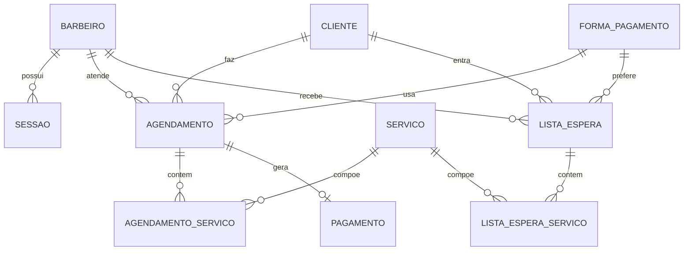

# Barber Point — sistema de agendamento para barbearia

Trabalho interdisciplinar de Modelagem de Processos de Negócios.
**Integrantes:** Eduardo, Marcos Felipe, Ramon, Gabriel Silva, Heberth

Aplicação completa (front-end, back-end e banco de dados relacional) que incorpora os processos do TO-BE
mapeado e ataca os problemas do AS-IS: agendamento por WhatsApp sem agenda central, conflitos de horário,
vagas ociosas após cancelamentos/faltas e demora no pagamento por falta de troco.

## Tecnologias
| Camada | Tecnologia |
|---|---|
| Front-end | HTML, CSS e JavaScript puro (`public/`) |
| Back-end | Python 3 (somente biblioteca padrão: `http.server`), API REST em JSON (`server.py`) |
| Banco de dados | **SQLite** (relacional), com chaves primárias/estrangeiras, `CHECK`, `UNIQUE` e índice único parcial (`db/schema.sql`) |

## Como executar
Requer apenas Python 3.9+ (nada para instalar).
```bash
python3 server.py
# abra http://localhost:8000
```
O banco `db/barberpoint.db` é criado sozinho na primeira execução, com serviços, formas de pagamento e três barbeiros de teste.
- Barbeiro de teste: `carlos@bp.com` / `123456` (também `rafael@bp.com` e `diego@bp.com`).
- Novo barbeiro: "Sou barbeiro" > "Criar conta" com o ID da barbearia `BP2026` (variável `SHOP_ID`).
- Taxa da barbearia: 20% (variável `TAXA`).

## Processos do TO-BE implementados
| Processo mapeado | Onde está |
|---|---|
| Cliente seleciona serviços (barba, cabelo, lavagem, tintura), barbeiro, data e horário | Tela "Agendar" |
| Verificar disponibilidade / "possui data e hora disponível?" | Horários ocupados riscados; o banco recusa duplicidade (índice único parcial) |
| Confirmar agendamento e avisar quando não há vaga | Código do agendamento; mensagem de horário ocupado |
| Cadastro e login do barbeiro com ID da barbearia | Tela "Sou barbeiro" (senha com PBKDF2 + sessão no banco) |
| Barbeiro confirma disponibilidade e atendimento | Agenda do barbeiro: Confirmar/Recusar |
| Liberar pagamento e confirmar pagamento | "Concluir e liberar pagamento" > "Registrar pagamento" |
| Pagamento por Pix, cartão ou dinheiro | Passo 5 do agendamento |

Além do mapeado (lacunas apontadas no levantamento): **lista de espera** com reserva da vaga liberada,
**lembretes** (aviso na tela + botão de WhatsApp), **troco** informado no pagamento em dinheiro e
**taxa de 20% da barbearia** (bruto, taxa e líquido no resumo do dia).
O cliente agenda como **visitante** (nome e telefone) e usa um código de 8 caracteres para consultar/cancelar.

## Modelo de dados (ER)

Regra central contra conflito de agenda: `CREATE UNIQUE INDEX ux_horario_ativo ON agendamento(barbeiro_id,data,hora) WHERE status IN ('pendente','confirmado','concluído')`.
Cancelar, recusar ou marcar falta libera o horário automaticamente.

## API (resumo)
`GET /api/servicos`, `/api/barbeiros`, `/api/horarios?barbeiro=&data=` · `POST /api/agendamentos` · `GET /api/agendamentos/<codigo>` · `POST /api/agendamentos/<codigo>/cancelar`
· `POST /api/espera`, `POST /api/espera/<id>/reservar`, `DELETE /api/espera/<id>` · `POST /api/login`, `/api/cadastro`, `/api/logout` ·
`GET /api/agenda?data=` e `POST /api/agendamentos/<codigo>/acao` (barbeiro autenticado).

## Evidências (`docs/evidencias/`)
Geradas por `python3 scripts/gerar_evidencias.py` (executa os fluxos reais na interface, com banco temporário; requer `pip install playwright matplotlib` e `playwright install chromium`).
- **Telas:** `01` a `16` (agendar, troco, confirmação com código, meus agendamentos, horário ocupado e lista de espera, consulta por código, login e cadastro do barbeiro, agenda com pendentes, confirmação, liberação de pagamento, resumo com taxa de 20%, vaga livre, vaga liberada e reserva pela fila).
- **Banco preenchido:** `db_<tabela>.png` das 10 tabelas, mais o dump `db/dados_exemplo.sql`.

## Limitações
Lembretes automáticos por SMS/e-mail e cobrança online de cartão/Pix não estão incluídos (o pagamento é registrado como status).
Para produção, trocar o servidor por um framework (Flask/Express) e o SQLite por PostgreSQL/MySQL, sem mudar o modelo de dados.
